# 主动ETF · 提速版 V12

约3分06秒，1920×1080，30fps。配音提升至1.15倍并保持音高，字幕与动效同步；选片、等待下单、放入银片及结尾阅读停顿保留。本版按用户要求不加BGM，仅有配音。

- [下载V12提速版视频](videos/active-etf-speed-v12.mp4?raw=true)
- [下载V12可编辑工程](active-etf-speed/editable-project.zip?raw=true)
- [完整分镜与口播](active-etf-speed/production-plan.md)
- [字幕](active-etf-speed/subtitles.srt)

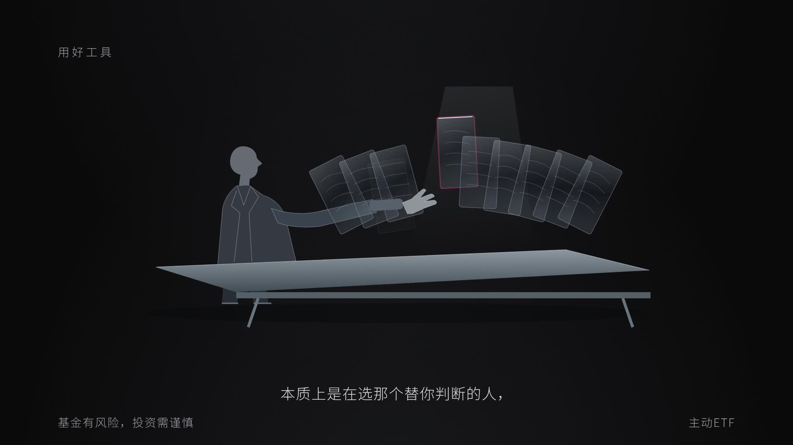

画面沿用V11，片尾仅三条提示和风险提示。旧版本保留。

---

# 主动ETF · 判断力、纪律与合拍 V11

约3分29秒，1920×1080，30fps。工具箱去字，灯泡瘦长、灯芯更亮且柔光扩大，标签改为3 Tips。三条标题念完后分别展开：半侧影经理先排除再选择抽象薄片；价格差异收窄后再下单；暖白双轨与节拍器合拍后放入银片。片尾只保留三条提示和底部风险提示。

- [下载V11新版视频](videos/active-etf-method-v11.mp4?raw=true)
- [下载V11可编辑工程](active-etf-method/editable-project.zip?raw=true)
- [完整分镜与口播](active-etf-method/production-plan.md)
- [字幕](active-etf-method/subtitles.srt)
- [沿用数据来源](active-etf-method/sources.md)

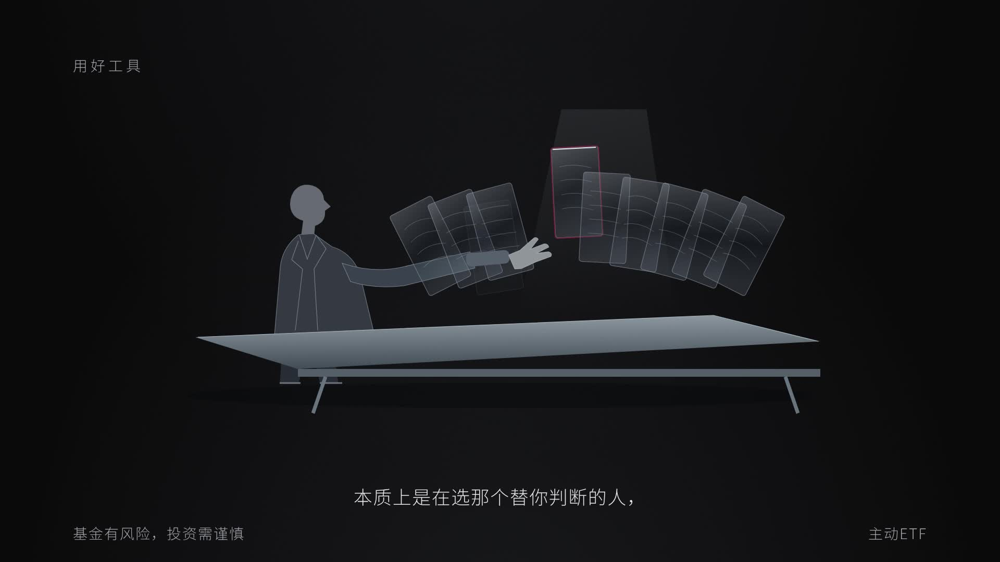

三段完整口播保留，新增动作停顿。地球保持无地点文字。旧版本全部保留。

---

# 主动ETF · 用好工具 V10

约3分22秒，1920×1080，30fps。地球仅保留地点焦点与闪烁，删除北京/纽约文字。原第08、09镜替换为三页：透明、便宜、灵活三件工具入箱合盖；工具箱收束成灯泡，关键词处灯芯亮起；三条使用提示随完整口播依次出现，当前项提亮并微放大，讲完复原转灰。

- [下载V10新版视频](videos/active-etf-tools-v10.mp4?raw=true)
- [下载V10可编辑工程](active-etf-tools/editable-project.zip?raw=true)
- [完整分镜与口播](active-etf-tools/production-plan.md)
- [字幕](active-etf-tools/subtitles.srt)
- [沿用数据来源](active-etf-tools/sources.md)

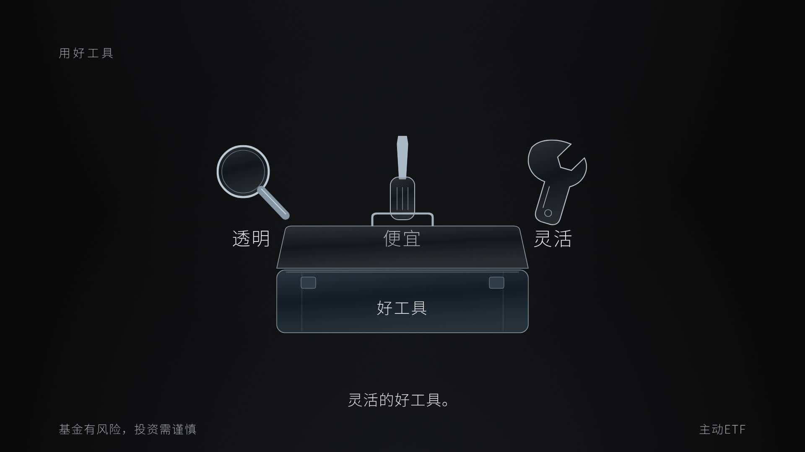

三段提示完整保留，段落间留阅读停顿，原收束和片尾继续衔接。旧版保留。

---

# 主动ETF · 全球视野 V9

约2分52秒，1920×1080，30fps。安全阀左侧取消100只及上限刻度，保留30只下限。分散约束后新增全球视野：透明地球北京转纽约、规模数字增至2.5万亿美元、美国新发主动产品八成多饼图、转回北京、主动管理拼块归位。

- [下载V9新版视频](videos/active-etf-global-v9.mp4?raw=true)
- [下载V9可编辑工程](active-etf-global/editable-project.zip?raw=true)
- [完整分镜与口播](active-etf-global/production-plan.md)
- [数据与素材来源](active-etf-global/sources.md)
- [字幕](active-etf-global/subtitles.srt)

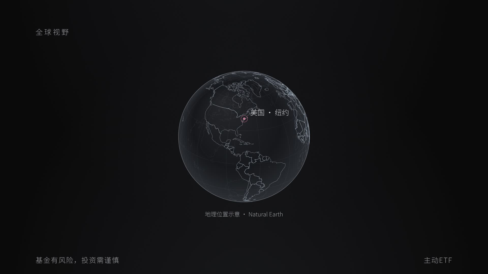

全球规模采用2026年6月底口径；美国新发产品占比采用2025年产品数量口径；国内“跨过5万亿元”明确标注2025年8月历史日期。地球国界来自公共领域Natural Earth，仅作位置示意。旧版保留。

---

# 主动ETF · 分散约束四页 V8

约2分17秒，1920×1080，30fps。用户已允许延长。分散约束改为四页：问号展开持仓疑问；策略环形图随旁白高亮；稳字散开为粒子并聚成进字；股票数量降至30只、前十大权重升至60%，分别停止并红色闪烁预警。

- [下载V8新版视频](videos/active-etf-constraints-v8.mp4?raw=true)
- [下载V8可编辑工程](active-etf-constraints/editable-project.zip?raw=true)
- [完整分镜与口播](active-etf-constraints/production-plan.md)
- [字幕](active-etf-constraints/subtitles.srt)

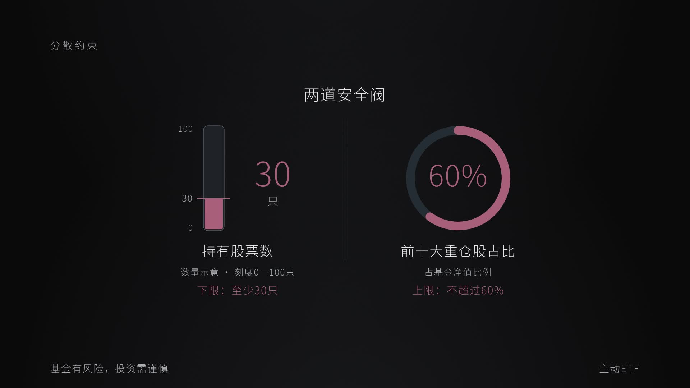

图中均衡9只、价值4只、红利3只，合计16只，其他2只灰色单列，分类待补充。左侧数量柱使用0—100只的示意刻度，不是百分比。

---

# 主动ETF · 三项区别导航 V7

约1分59秒，1920×1080，30fps。03分镜新增“交易、透明、成本”逐项总览；点击交易展开同一时间轴的发行认购与上市交易，重点突出交易时段内按市场价格买卖；点击透明进入04，点击成本进入05。保留石墨黑空间、烟灰玻璃和局部语音3%强调。

- [下载V7新版视频](videos/active-etf-navigation-v7.mp4?raw=true)
- [下载V7可编辑工程](active-etf-navigation/editable-project.zip?raw=true)
- [完整分镜与口播](active-etf-navigation/production-plan.md)
- [字幕](active-etf-navigation/subtitles.srt)

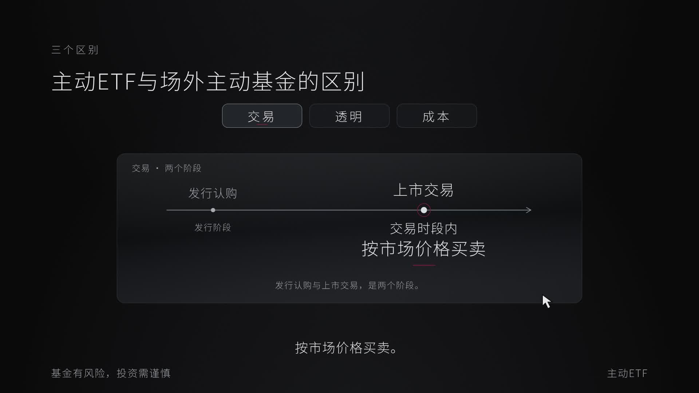

---

# 主动ETF · 点击展开与选股演示 V6

约1分57秒，1920×1080，30fps。开场银白光线带亮点与短尾绕文字一圈；第二镜依次点击主动管理和ETF，展开经理选股、股票走势、持仓分布和数字界面，最后返回双按钮总结。

- [下载V6新版视频](videos/active-etf-interactive-v6.mp4?raw=true)
- [下载V6可编辑工程](active-etf-interactive/editable-project.zip?raw=true)
- [执行分镜](active-etf-interactive/production-plan.md)
- [制作说明](active-etf-interactive/README.md)

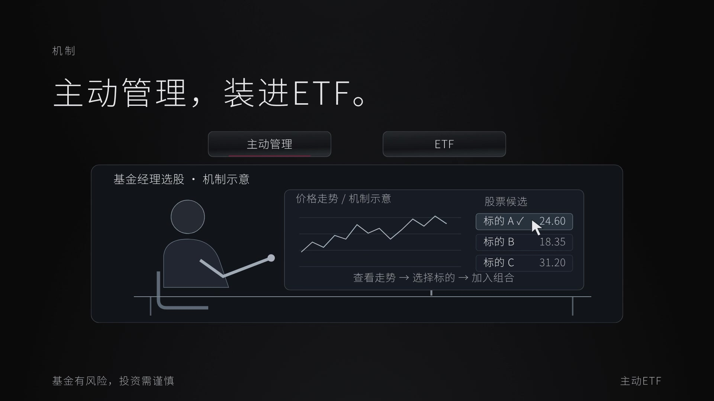

所有新标的、报价、权重与走势均为机制示意。为演示插入3秒停顿，原始配音未重录或加速。

---

# 主动ETF · 石墨黑空间 V5

约1分54秒，1920×1080，30fps。有层次的石墨黑背景、烟灰透明玻璃、银灰薄边与极小深红重音。开场删除列阵，两句居中先后出现：主动ETF → 多一种选择；单圈细线动效仅用于第二句，无泛光和粒子。

- [下载V5深色版视频](videos/active-etf-dark-centered-v5.mp4?raw=true)
- [下载V5可编辑工程](active-etf-dark/editable-project.zip?raw=true)
- [本版制作方案](active-etf-dark/production-plan.md)
- [制作说明](active-etf-dark/README.md)

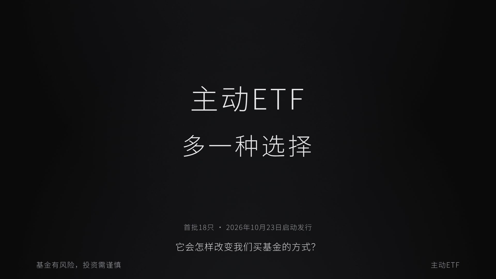

---

# 主动ETF · 玻璃质感版 V4

约1分54秒，1920×1080，30fps。通透微磨砂玻璃、暖白背景、少量深红。沿用V3的文件夹展开、分支细线和53处语音同步3%轻微放大，念完复原。

- [下载V4玻璃版视频](videos/active-etf-glass-voice-sync-v4.mp4?raw=true)
- [下载V4可编辑工程](active-etf-glass/editable-project.zip?raw=true)
- [制作说明](active-etf-glass/README.md)

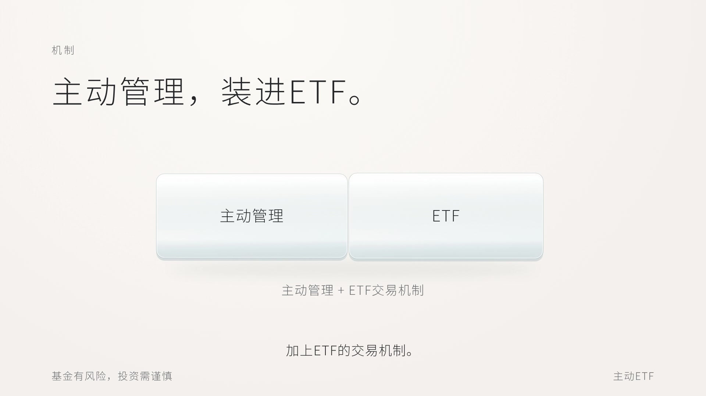

---

# 主动ETF · 语音同步动效版 V3

约1分54秒，1920×1080，30fps。暖白银色极简风；图中当前讲解内容轻微放大3%，念完恢复，字幕和全景保持稳定。接入文件夹展开与分支细线动效。

- [下载V3新版视频](videos/active-etf-minimal-voice-sync-v3.mp4?raw=true)
- [下载V3可编辑工程](active-etf-voice-sync/editable-project.zip?raw=true)
- [语音强调时间表](active-etf-voice-sync/voice-emphasis.json)
- [制作说明](active-etf-voice-sync/README.md)

---

## 可复用动效库

[组件目录与用法](motion-library/README.md) · [本片建议应用方案](motion-library/CURRENT_VIDEO_PLAN.md)

收录Shredder、FlipCard、BranchedMenu、FolderFloat和StarBorder，包含原始React源码、参数、CSS及HyperFrames时间轴适配。动效库已入库；V3已应用文件夹展开、分支细线和语音同步强调。

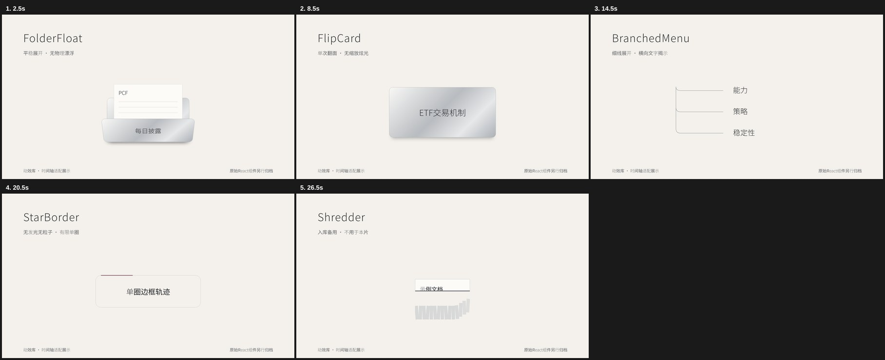

---

# 主动ETF，多一种选择。 · 暖白银色极简版

约1分54秒，1920×1080横版，30fps。暖白影棚、银色金属、少量深红、纤细字体与横向文字遮罩。含中文男声、同步字幕和稀疏氛围音乐，采用直接切换。

- [下载新版极简成片 MP4](videos/active-etf-minimal-16x9-v2.mp4?raw=true)
- [下载可编辑 HyperFrames 工程](active-etf-minimal/editable-project.zip?raw=true)
- [下载独立字幕 SRT](active-etf-minimal/subtitles.srt?raw=true)
- [制作说明](active-etf-minimal/README.md)

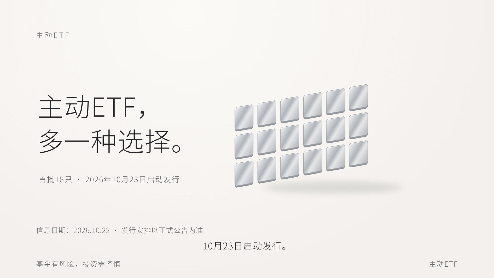

---

# 主动ETF · 金融科技风横版（本次第一版）

1分54秒，1920×1080横版，30fps。含中文男声、同步字幕和电子氛围配乐。

- [下载本次横版成片 MP4](videos/active-etf-fintech-16x9-v1.mp4?raw=true)

---

# 18只主动ETF来了 · 两分钟解读

1分53秒，1080×1920竖屏，30fps。米白、墨黑与琥珀色动态图解，包含中文AI旁白、字幕、原创背景音乐和风险提示。

- [下载成片 MP4](videos/active-etf-explainer-20261023.mp4?raw=true)
- [下载字幕 SRT](active-etf-explainer/subtitles.srt?raw=true)
- [下载可编辑工程 ZIP](active-etf-explainer/editable-project.zip?raw=true)
- [旁白文案](active-etf-explainer/旁白文案.txt)

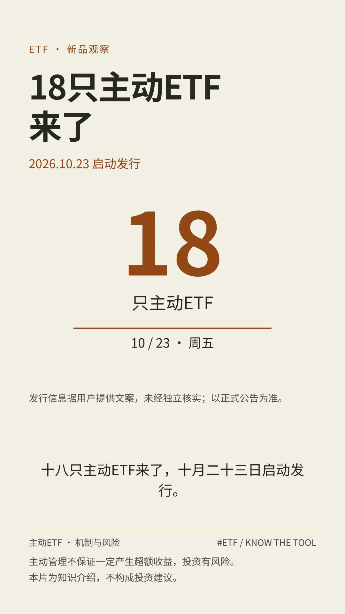

发行数量及2026年10月23日发行日期来自提供的文案，未经独立核实；以正式公告为准。视频已对完整持仓披露、费用及结算规则等绝对化表述作审慎调整。本片为知识介绍，不构成投资建议。主动管理不保证一定产生超额收益，投资有风险。

成片已通过H.264/AAC完整解码检查、画面布局与对比度检查。可编辑工程包含动画HTML、镜头文案、时间表、旁白、音乐、字幕及生成脚本，不含本地语音模型和依赖目录。

---

# 主动 ETF · Ink Press 品类宣传片（新版）

36.2秒，10个镜头，1920×1080，30fps，纸墨琥珀风格。

## 本次修改

全片围绕“主动管理、信息披露、交易便利”三个品类特点展开。开场、信息镜头和收尾使用中性的机制图解，不再以某一只基金贯穿始终。

真实官网素材仅在第3镜头短暂辅助展示两个不同ETF（AVUV/AVUS）的官方标题/代码摘录；不呈现其收益率或费率，不构成产品推荐，也不代表境内基金规则。图解均清楚标注“机制示意”，不是实际交易界面或行情。

末5秒保留完整静态风险提示：

> 主动管理不保证一定产生超额收益，投资有风险。

## 下载视频

- [配乐版 MP4](videos/active-etf-music.mp4?raw=true)
- [无配乐版 MP4（保留音效）](videos/active-etf-sfx.mp4?raw=true)

若打开的是GitHub文件页面，点击 **Download raw file / 下载原始文件**，保存到本地桌面。旧版保留在Git提交历史中，当前文件为新版。

## 来源与验证

- [AVUV 官方页面](https://www.avantisinvestors.com/avantis-investments/en-us/avantis-us-small-cap-value-etf/)
- [AVUS 官方页面](https://www.avantisinvestors.com/avantis-investments/en-us/avantis-us-equity-etf/)

官网摘录通过保留HTTPS验证的静态归档进行浏览器采集，仅裁取标题与代码区域，未改写官方信息。没有使用未经核实的费率、规模或收益宣传数据。

已检查新版10个镜头、末5秒风险提示、1085帧视频时长和双版本画面一致性。配乐和riser为程序原创合成，电影系音效来自video-shotcraft素材库内登记来源的Mixkit素材。视觉与动作按[video-shotcraft](https://github.com/Vincentwei1021/video-shotcraft)的Ink Press模板语法适配。

## 《方向》30 秒程序动画样片

深灰背景、暖白光束，四镜结构。包含字幕、环境音与轻音效，以及末 5 秒静态风险提示。目前未加入人声旁白。

- [下载 1080p 视频](videos/direction-1080p.mp4?raw=true)
- [下载 4K 视频（由 720p 程序画面上采样）](videos/direction-4k.mp4?raw=true)
- [制作说明](direction/制作说明.txt)
- [旁白时间表](direction/旁白时间表.txt)

程序与字幕文件保存在 `direction/`，原有主动 ETF 视频保留。
